# ComfyUI-Fossiel-QoL-Nodes

ComfyUI-Fossiel-QoL-Nodes is a suite of custom nodes for ComfyUI to improve quality of life. These nodes have been developed for personal use but maybe you’ll find them useful as well.

## Nodes (Listed Alphabetically)

### Add Silence to Audio

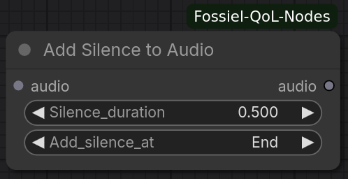

Adds a configurable duration of silence to the start, end, or both ends of an audio clip. Useful for padding audio before/after generation or aligning audio with video timelines.

#### Specifications

**Inputs:**
1. **audio** – Audio dictionary (waveform + sample_rate)

**Parameters:**
1. **Silence_duration** – Length of silence in seconds (0.0–60.0, default 0.5)
2. **Add_silence_at** – Where to insert the silence: `Start`, `End`, or `Both`

**Outputs:**
1. **audio** – Modified audio with silence added

---

### Color Match (Passthrough Ports)

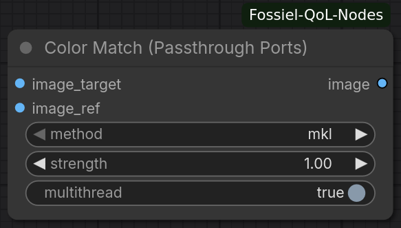

Color transfer / matching node based on the excellent ColorMatch implementation by **Kijai** (from [ComfyUI-KJNodes](https://github.com/kijai/ComfyUI-KJNodes)).

The only change is the port order: `image_target` is the top input so that when the node is bypassed, ComfyUI correctly passes the target image through instead of the reference.

Supports multiple transfer methods (mkl, hm, reinhard, mvgd, and compound variants) with optional strength and multithreading.

#### Specifications

**Inputs:**
1. **image_target** – Image to be color-matched (top port for correct bypass behaviour)
2. **image_ref** – Reference image whose colors will be transferred

**Parameters:**
1. **method** – Color transfer algorithm (`mkl` default)
2. **strength** – Blend strength of the matched result (0.0–10.0, default 1.0)
3. **multithread** – Enable multi-threaded processing for batches (default True)

**Outputs:**
1. **image** – Color-matched result

**Credits:** Original ColorMatch node by Kijai. Modified only for port ordering.

---

### Denoise Precision KSampler

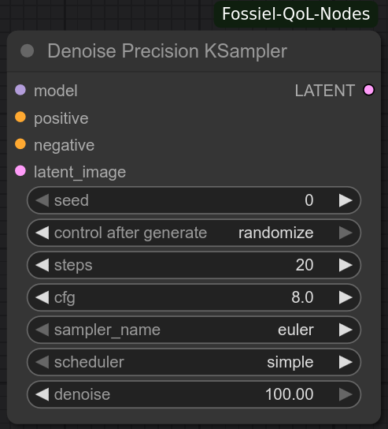

This node is an exact clone of the ComfyUI core KSampler with only one difference -> The Denoise parameter is represented as a percentage instead of a fraction. This effectively adds 2 decimal places to the value and allows for extremely precise settings.  

---

### Force Eager DeltaNet

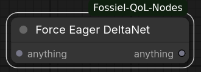

Passthrough node that forces pure-PyTorch paths for Qwen 3.5 / TextGenerate by disabling the fused comfy-kitchen CUDA kernels that require a newer driver.

Wire any value through this node before TextGenerate so it is guaranteed to run first. Does not alter the data and does not affect normal Qwen Image 2.1 image generation.

#### Specifications

**Inputs:**
1. **anything** – Any type (passthrough).

**Outputs:**
1. **anything** – The same value, unchanged.

**Notes:**
- Applies the force-eager patch only once per session.
- Useful when your NVIDIA driver is too old for the fused kernels used by Qwen 3.5 TextGenerate.

---

### FossielCentralControl_v3

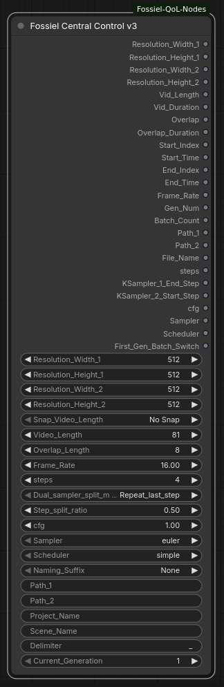

This node is your go-to hub for managing settings in ComfyUI. It simplifies creating video clips in multiple consecutive runs (like extending a sequence) but it's versatile enough to work great for any ComfyUI project, keeping things organized and easy.

**Note:** FossielCentralControl_v2 remains available for backwards compatibility with existing workflows.

#### Specifications

**Parameters:**
1. **Resolution Settings** – Two independent resolution pairs (Width/Height 1 and 2) that are passed straight through.
2. **Video Settings**
   - *Snap_Video_Length* – Optional snapping of frame count to model-specific grids (`No Snap`, `LTX`, `MiniMax`, `Wan`).
   - *Video_Length* – Number of frames (snapped if selected).
   - *Overlap_Length* – Frames of overlap between consecutive clips.
   - *Frame_Rate* – Frames per second.
   - Start/End indices and times are calculated from Current Generation, Video Length and Overlap.
   - *First Generation Switch* – Boolean (1 for first clip, 0 otherwise).
3. **Sampling and Naming Settings**
   - *steps* – Total sampling steps (snapped to even).
   - Dual-sampler split method + ratio → `KSampler_1_End_Step` / `KSampler_2_Start_Step`.
   - *cfg*, *Sampler*, *Scheduler*.
   - *File Naming* – Project_Name + Scene_Name + optional GenXXX suffix, joined by Delimiter. Empty fields are skipped.
   - Two free-form path strings (Path_1 / Path_2) for convenience.

**Outputs:**
1. **Resolution_Width_1 / Height_1 / Width_2 / Height_2**
2. **Vid_Length**, **Vid_Duration**, **Overlap**, **Overlap_Duration**
3. **Start_Index**, **Start_Time**, **End_Index**, **End_Time**
4. **Frame_Rate**, **Gen_Num**, **Batch_Count**
5. **Path_1**, **Path_2**, **File_Name**
6. **steps**, **KSampler_1_End_Step**, **KSampler_2_Start_Step**
7. **cfg**, **Sampler**, **Scheduler**
8. **First_Gen_Batch_Switch**

**Notes:**
- Cleaner and more flexible than v2 (dual resolutions, model-aware frame snapping, path helpers).
- Naming still avoids double delimiters.

---

### Generate Text (Expanded)

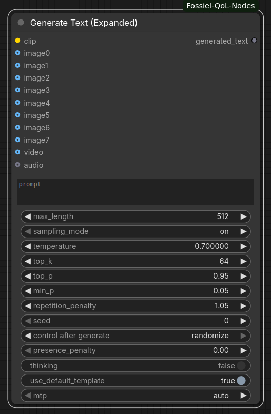

A clone of the ComfyUI native Generate Text node with the exception that this node supports multiple images without having to batch them.

#### Specifications

**Optional Inputs** *(Only additional to the Comfy-core node)*

1. **image0** – Renamed from "image"  
2. **image1..image7** – Added input ports  

---

### Image Level Matcher

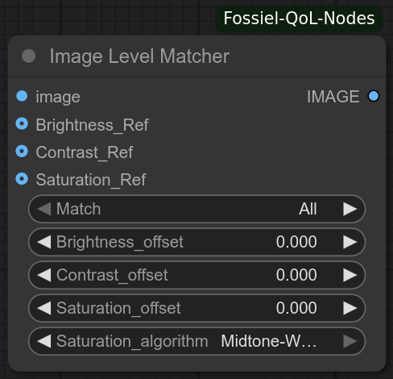

On the surface, it's yet another brightness and contrast adjuster. However, this node allows you to match the brightness and contrast levels from a reference image, in addition to normal level settings. It was developed with the aim of adjusting greyscale images but it's equally as effective on color images. The levels can be fine tuned using the parameters.  

***Important:*** *When loading a batch of images, only the first frame will be used to match the levels in order to prevent flickering*  

#### Specifications

**Inputs:**
1. **image** – The image to be adjusted (required)  
2. **Brightness_Ref** – Reference image for brightness matching (optional)  
3. **Contrast_Ref** – Reference image for contrast matching (optional)  
4. **Saturation_Ref** – Reference image for saturation matching (optional)  

**Parameters:**  
1. **Match** – Choose what levels to match/adjust:  
   - `All` *(default)* – Match/Adjust all parameters  
   - `Brightness Only` – Match/Adjust only brightness  
   - `Contrast Only` – Match/Adjust only contrast  
   - `Saturation Only` – Match/Adjust only saturation  
   - `Brightness & Contrast` – Match/Adjust brightness & contrast  
   - `Brightness & Saturation` – Match/Adjust brightness & saturation  
   - `Contrast & Saturation` – Match/Adjust contrast & saturation  
2. **Brightness_offset** – Fine tune/Adjust brightness (-1.000–1.000).  
3. **Contrast_offset** – Fine tune/Adjust contrast (-1.000–1.000).  
4. **Saturation_offset** – Fine tune/Adjust saturation (-1.000–2.000).  
5. **Saturation_algorithm** – Choose what levels to match/adjust:  
   - `Global` – Will match based on the mean saturation level of the reference  
   - `Midtone-Weighted` *(default)* – Will match based on the highlight, midtone & shadow saturation levels of the reference  

**Outputs:**
1. **IMAGE** – Adjusted image  

---

### Image Level Matcher (Advanced)

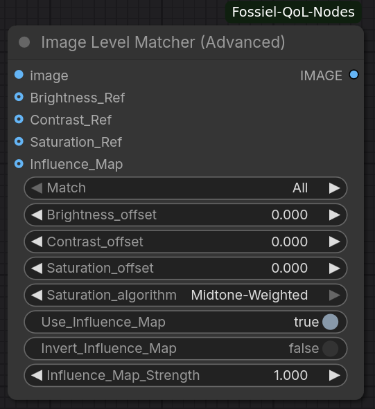

Advanced version of Image Level Matcher. In addition to matching brightness, contrast and saturation from reference images (or applying manual offsets), this node supports an optional **Influence Map**. The influence map controls where the level adjustments are applied, allowing selective / masked correction while leaving other areas untouched.

***Important:*** *When loading a batch of images, only the first frame will be used to match the levels in order to prevent flickering*  

#### Specifications

**Inputs:**
1. **image** – The image to be adjusted (required)  
2. **Brightness_Ref** – Reference image for brightness matching (optional)  
3. **Contrast_Ref** – Reference image for contrast matching (optional)  
4. **Saturation_Ref** – Reference image for saturation matching (optional)  
5. **Influence_Map** – Optional grayscale / RGB image that controls the strength of the adjustment per pixel (optional)  

**Parameters:**  
1. **Match** – Choose what levels to match/adjust:  
   - `All` *(default)* – Match/Adjust all parameters  
   - `Brightness Only` – Match/Adjust only brightness  
   - `Contrast Only` – Match/Adjust only contrast  
   - `Saturation Only` – Match/Adjust only saturation  
   - `Brightness & Contrast` – Match/Adjust brightness & contrast  
   - `Brightness & Saturation` – Match/Adjust brightness & saturation  
   - `Contrast & Saturation` – Match/Adjust contrast & saturation  
2. **Brightness_offset** – Fine tune/Adjust brightness (-1.000–1.000).  
3. **Contrast_offset** – Fine tune/Adjust contrast (-1.000–1.000).  
4. **Saturation_offset** – Fine tune/Adjust saturation (-1.000–2.000).  
5. **Saturation_algorithm** –  
   - `Global` – Match based on the mean saturation level of the reference  
   - `Midtone-Weighted` *(default)* – Match based on highlight / midtone / shadow saturation levels of the reference  
6. **Use_Influence_Map** – Enable / disable the influence map (default: True).  
7. **Invert_Influence_Map** – Invert the influence map so dark areas receive the adjustment instead of bright ones.  
8. **Influence_Map_Strength** – Overall strength of the influence map (0.000–2.000). Values > 1.0 push the map toward full white.

**Outputs:**
1. **IMAGE** – Adjusted image  

---

### Latent Passthrough Inpaint Conditioning

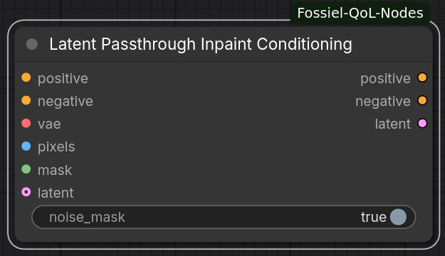

Based on the ComfyUI core node. Prepares positive / negative conditioning and a latent for inpainting. It encodes a masked version of the input image (pixels outside the mask are neutralised) and optionally injects a noise mask so sampling only occurs inside the masked region.

You can supply an existing latent (e.g. from a previous stage) instead of re-encoding the original image.

#### Specifications

**Inputs:**
1. **positive** – Positive conditioning  
2. **negative** – Negative conditioning  
3. **vae** – VAE used for encoding  
4. **pixels** – Image to inpaint  
5. **mask** – Inpaint mask  
6. **latent** *(optional)* – Pre-existing latent; if omitted the original image is encoded  

**Parameters:**
1. **noise_mask** – Whether to attach a noise mask to the latent so sampling is restricted to the mask area (default: True).

**Outputs:**
1. **positive** – Conditioning with `concat_latent_image` + `concat_mask` set  
2. **negative** – Conditioning with `concat_latent_image` + `concat_mask` set  
3. **latent** – Latent ready for sampling (optionally with noise_mask)

---

### Latent I/O

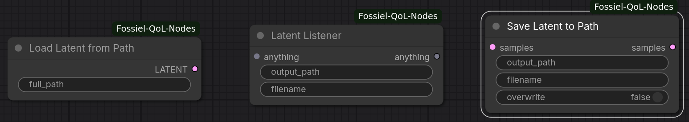

A small family of three nodes for saving, loading and pre-validating `.latent` files.

*Support for MiniMax H3 nested latents (video + audio) added on 2026/10/12*

**Save Latent**  
Saves a latent tensor to a user-specified directory + filename (auto-appends `.latent` if missing). Supports overwrite control and optional workflow metadata.

**Load Latent**  
Loads a `.latent` file from a full path. Automatically applies the historic SD 1.x scale factor when the file lacks the modern format marker.

**Latent Listener**  
Early-validation guard. Performs the same path / filename checks as Save Latent (without the overwrite option). Place it before a KSampler (or any early node) so the workflow aborts cleanly if the target file already exists or the path is invalid. Passes the input through unchanged when everything is fine.

#### Specifications (Save Latent)

**Inputs:**
1. **samples** – Latent to save  

**Parameters:**
1. **output_path** – Directory path (must be a folder, not a file)  
2. **filename** – Filename only (no path separators)  
3. **overwrite** – Allow overwriting an existing file (default: False)

**Outputs:**
1. **samples** – The same latent (passthrough)

#### Specifications (Load Latent)

**Parameters:**
1. **full_path** – Complete path including filename (e.g. `/path/to/file.latent`)

**Outputs:**
1. **LATENT** – Loaded latent tensor

#### Specifications (Latent Listener)

**Inputs:**
1. **anything** – Any type (passthrough)

**Parameters:**
1. **output_path** – Directory that will be used later by Save Latent  
2. **filename** – Filename that will be used later by Save Latent  

**Outputs:**
1. **anything** – The same value, unchanged (or raises a clear error)

---

### Pixel Budgeting

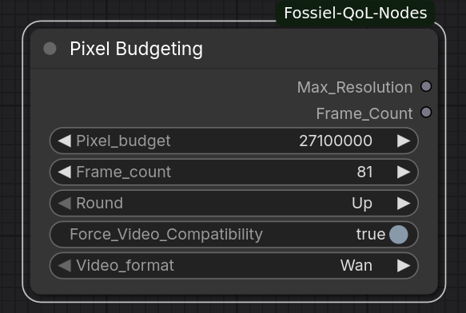

This is a simple math node which was specifically designed to help overcome OOMs in low VRAM video workflows. The node allows a total pixel budget and frame count to be set for a video clip. Based on the budget and the frame count, it then outputs the maximum square resolution. When used in combination with the Resolution Wrangler node from this pack, a clip of any aspect ratio can be generated while fitting within the total pixel budget for the clip.  

#### Specifications

**Parameters:**
1. **Pixel_budget** – The total number of pixels available for a video clip. E.g. to generate a clip of 81 frames at a frame size of 1024x1024, would require a budget of 81 x (1024 x 1024) = 84934656  
2. **Frame_count** – The length of the video in frames.  
3. **Round** – The direction of integer rounding.  
4. **Force_Video_Compatibility** - When set to true, the output frame count will snap to the next multiple determined by the Video_format selector. E.g. when Frame_count is set to 79, the output count will snap to 81 for the Wan video model family.  
5. **Video Format** - Determines the frame count snapping behavior when Force_Video_Compatibility is enabled and is ignored when the latter is disabled.

**Outputs:**
1. **Max_Resolution** – The maximum side-length of the square frame which fits inside the pixel budget at the current frame count.  
2. **Frame_Count** – Passes the value of Frame_count and optionally snaps to the next compatible count.  

---

### Python Script (Simple)

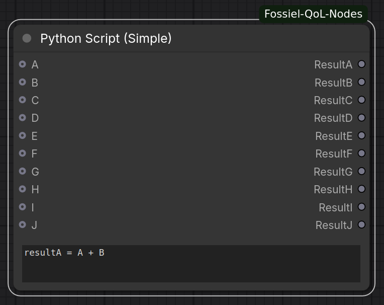

A lightweight, sandboxed Python expression node. Accepts up to 10 optional numeric inputs (A–J). Unconnected inputs default to 0. You write a short script that assigns any of `resultA`–`resultJ`. Only pure math and a small set of safe builtins are allowed (no imports, no file access, no dunder attributes).

Ideal for quick calculations, custom math, or simple logic without leaving the graph.

#### Specifications

**Optional Inputs:**
- **A** … **J** – Any numeric value (int/float). Unconnected → 0. Booleans are rejected.

**Parameters:**
1. **script** – Multi-line Python snippet. Must assign at least one of `resultA`–`resultJ`.  
   Example: `resultA = (A + B) / 2`  
   The `math` module is available.

**Outputs:**
1. **ResultA** … **ResultJ** – Values assigned in the script (unset results default to 0)

**Notes:**
- Strict sandbox: no imports, no attribute access starting with `__`.
- Only int/float results are accepted.

---

### Qwen Size Stabilizer (No Longer in this pack. Moved it to ComfyUI-Fossiel-QwenHelpers)

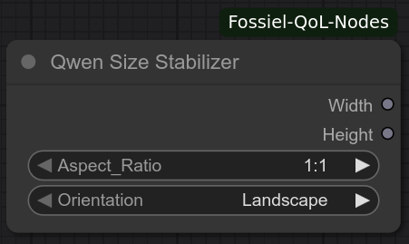

If you've worked with Qwen Image Edit 2509 for any extended period of time, you will have probably experienced the unpredictability of the output when the resolution is set to a larger value than 1 megapixel (1024x1024). The Qwen Size Stabilizer node seeks to address this issue by allowing you to set an aspect ratio from a list of commonly used ones and the orientation of it. The resulting output is the exact chosen aspect ratio which is divisible by 2 and is as close as possible to the 1MP ceiling. Some aspects may exceed the 1MP threshold but by so little that the effect is neglegable.  

---

### Resolution Wrangler

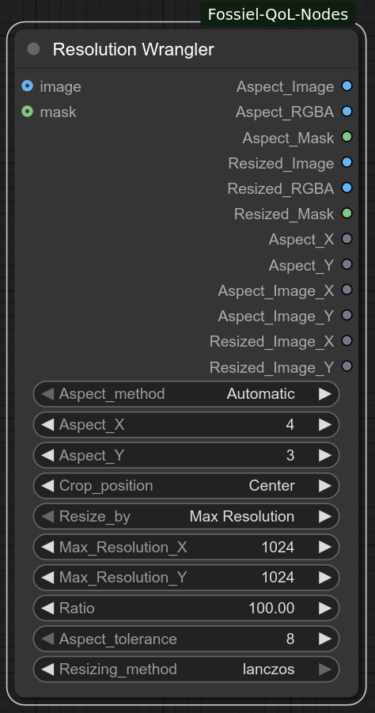

Resolution Wrangler is the ultimate VAE-compatible image sizer for ComfyUI. It automatically calculates the closest clean, non-fractional aspect ratio from your input image (or lets you set a manual ratio), crops the image perfectly to fill that aspect while preserving your chosen crop position, and then resizes the result to the largest size that maintains the **exact** aspect ratio, stays divisible by your selected VAE tolerance (8 or 16), and fits within your desired pixel budget.

The resulting image is **100% VAE compatible** at any size — no fractional scaling artifacts, no aspect drift, no wasted pixels.  

One of the many powerful use cases: if you're not blessed with a monster GPU and want to generate the largest possible 16:9 (or any other ratio) video or batch your hardware can comfortably handle, Resolution Wrangler will find the maximum clean resolution for you — every single time.

#### Specifications

**Parameters:**
1. **Aspect_method** – How to determine the target aspect ratio  
   - `Automatic` – Finds the closest clean integer ratio to the input image  
   - `Manual` – Use the user-defined Aspect_X : Aspect_Y ratio  
2. **Aspect_X** – Numerator of the manual aspect ratio (default: 4)  
3. **Aspect_Y** – Denominator of the manual aspect ratio (default: 3)  
4. **Crop_position** – Where to place the crop when expanding to fill the target aspect  
   - Options include: Center (default), Left and Top, Right and Bottom, X-Center and Top, etc.  
5. **Resize_by** – Controls how the target resolution / pixel budget is calculated  
   - `Max Resolution` (default) – Use the Max_Resolution_X × Max_Resolution_Y product as hard pixel cap  
   - `Ratio` – Scale from the cropped size by the Ratio percentage  
   - `Max Resolution x Ratio` – Scale by the Ratio percentage of the Max_Resolution_X × Max_Resolution_Y product  
6. **Max_Resolution_X** – Width for pixel cap calculation (default: 1024)  
7. **Max_Resolution_Y** – Height for pixel cap calculation (default: 1024)  
8. **Ratio** – Percentage scaling factor from cropped size when Resize_by = Ratio (default: 100.0, min: 0.10, max: 10000.0)  
9. **Aspect_tolerance** – Output dimensions must be divisible by this value (8 or 16) – ensures perfect VAE compatibility  
10. **Resizing_method** – Interpolation method for final resize  
    - `lanczos` (default), `bicubic`, `bilinear`, `nearest-exact`

**Optional Inputs:**
- **image** – RGB image to process (required for normal operation)  
- **mask** – Optional mask (ComfyUI convention: 0 = keep/opaque, 1 = masked/transparent) – preserved through cropping & resizing

**Outputs:**
1. **Aspect_Image** – Cropped RGB image exactly matching the target aspect (before final resize)  
2. **Aspect_RGBA** – Same as Aspect_Image but with alpha channel (from input mask or fully opaque)  
3. **Aspect_Mask** – Cropped mask (if provided), ComfyUI convention  
4. **Resized_Image** – Final RGB image resized to largest VAE-compatible size under the pixel budget  
5. **Resized_RGBA** – Final resized image with alpha channel applied (inverted mask → alpha)  
6. **Resized_Mask** – Final resized mask (ComfyUI convention)  
7. **Aspect_X** – Simplified numerator of the final aspect ratio  
8. **Aspect_Y** – Simplified denominator of the final aspect ratio  
9. **Aspect_Image_X** – Width of the Aspect_Image  
10. **Aspect_Image_Y** – Height of the Aspect_Image  
11. **Resized_Image_X** – Final resized width  
12. **Resized_Image_Y** – Final resized height  

---

### Sensor Switches

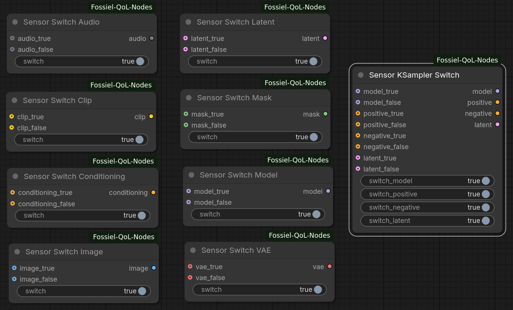

This is a set of switches with a very special ability: Besides being able to function like any other switch, these switches will detect which of their 2 input ports is active and send that to the output. This is particularly useful in workflows where group or node bypassing is present. Let's say, for example, you want to send either a generated or a loaded image to another node's input. You would then connect the VAE Decode node's output to the first input of the Sensor Switch Image node and a Load Image node to the second input. Whichever of the two is not bypassed, will be sent to the destination node. If both inputs are active, the True/False toggle becomes active and the switch works like any other switch.  

Available switches: Image, Clip, Conditioning, Latent, Mask, Model, VAE, **Audio**, and a multi-port KSampler Switch.

*IMPORTANT*: Due to ComfyUI's ability to allow data to pass through a bypassed node, the sensor nodes won't automatically switch when such a pass through situation occurs. To be safe, always switch to the desired input manually. Even with this limitation, these nodes will not error out if an input is not detected, which still makes them extremely useful.  

*Updated 2025/10/31*:  
The Sensor Switch Latent now also supports the latent format for WAN 2.1 & 2.2

*Updated 2026/10/24*:  
Added Sensor Switch Audio.

---

### Sequence Wrangler

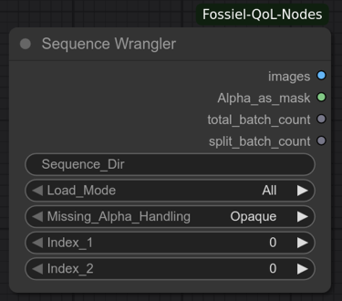

This node allows you to load and manipulate image sequences, as though they were videos. You can manipulate the output batch to your liking or output single frames. It also supports image files with an alpha channel.  

***Important:*** *This node does not support animated image formats such as WebP and GIF. However, it does support static images in these formats.*  

#### Specifications

**Parameters:**
1. **Sequence_Dir** – Full path to the directory containing the sequence. (e.g., `C:\path\to\directory`).  
2. **Load Mode** – Choose how to extract frames:  
   - `All` – Load every frame  
   - `From first to Index 1` – Frames 0 to value of Index_1  
   - `From Index 1 to last` – Value of Index_1 to final frame  
   - `Index 1 to Index 2` – Between two indices  
   - `First frame` – Only frame 0  
   - `Last frame` – Final frame  
   - `Index 1 frame` – Single frame at value of Index_1  
   (Important: For all batch modes, the range includes the indexed frame(s). E.g. In `From first to Index 1` mode, with an index value of 3, a batch count of 4 will be output.)  
3. **Missing_Alpha_Handling** – Choose how to handle images without an alpha channel:  
   - `Opaque` – Will output a solid white mask frame  
   - `Transparent` – Will output a solid black mask frame  
4. **Index 1** – First index for range-based modes (0-based).  
5. **Index 2** – Second index for `Index 1 to Index 2` mode. (Ignored for all other modes)  

**Outputs:**
1. **images** – Batch of RGB frames as `IMAGE` tensor (float32, 0–1).  
2. **Alpha as mask** – Alpha channel as grayscale mask (1.0 = opaque). Solid alpha (all 0 or 1) is normalized to 1.0.  
3. **total_batch_count** – Total number of frames in the sequence.  
4. **split_batch_count** – Number of frames actually loaded.  

---

### SmolLM2 and SmolVLM2

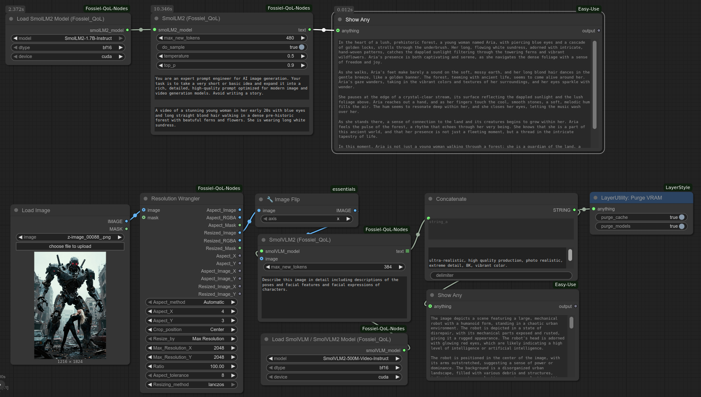

If you've been watching with envy as YouTubers use the Qwen3 LLM and VLM models to automate prompting but your VRAM-poor system won't allow you to participate, then these nodes are what you've been looking for. These are clones from the [LayerStyle_Advance node pack by chflame163](https://github.com/chflame163/ComfyUI_LayerStyle_Advance). The nodes have been modified to add support for the SmolLM2 and SmolVLM2 family of models. These models are known for their extremely efficient inference and run remarkably well on very low VRAM (as low as 4GB).

In addition to prompt-automation, SmolLM2 is also capable of ***writing lyrics for music generation with Ace-STEP 1.5*** and other music generators.

The SmolVLM2 model also supports video captioning but I have been unable to test that functionality because my 4GB VRAM isn't enough for analyzing video.  

***Important:*** *The SmolVLM2 model has trouble analyzing images with a 1:1 aspect ratio. To analyze perfectly square images, first pad/crop them to a rectangular aspect ratio before sending them for inference.*  

#### Supported Models

Download the **entire repository contents** (excluding any ONNX files) from the links below and place them in `ComfyUI/models/smol/`, each in its own subfolder matching the repo name (e.g. `ComfyUI/models/smol/SmolVLM2-500M-Video-Instruct/`).

| Model Name                          | Type          | Parameters | Hugging Face Link                                                                 | Notes / VRAM Recommendation                  |
|-------------------------------------|---------------|------------|-----------------------------------------------------------------------------------|----------------------------------------------|
| SmolLM2-135M-Instruct              | Text-only LLM | 135M      | [https://huggingface.co/HuggingFaceTB/SmolLM2-135M-Instruct](https://huggingface.co/HuggingFaceTB/SmolLM2-135M-Instruct) | Very lightweight, good for basic prompting   |
| SmolLM2-360M-Instruct              | Text-only LLM | 360M      | [https://huggingface.co/HuggingFaceTB/SmolLM2-360M-Instruct](https://huggingface.co/HuggingFaceTB/SmolLM2-360M-Instruct) | Balanced speed/quality                       |
| SmolLM2-1.7B-Instruct              | Text-only LLM | 1.7B      | [https://huggingface.co/HuggingFaceTB/SmolLM2-1.7B-Instruct](https://huggingface.co/HuggingFaceTB/SmolLM2-1.7B-Instruct) | **Recommended** for low-VRAM prompt engineering (best coherence on 4GB+) |
| SmolVLM-Instruct                   | Vision-LLM    | ~2B       | [https://huggingface.co/HuggingFaceTB/SmolVLM-Instruct](https://huggingface.co/HuggingFaceTB/SmolVLM-Instruct) | Original SmolVLM (Gen1), image-only          |
| SmolVLM2-256M-Video-Instruct       | Video-VLM     | 256M      | [https://huggingface.co/HuggingFaceTB/SmolVLM2-256M-Video-Instruct](https://huggingface.co/HuggingFaceTB/SmolVLM2-256M-Video-Instruct) | Smallest video-capable, very low VRAM        |
| SmolVLM2-500M-Video-Instruct       | Video-VLM     | 500M      | [https://huggingface.co/HuggingFaceTB/SmolVLM2-500M-Video-Instruct](https://huggingface.co/HuggingFaceTB/SmolVLM2-500M-Video-Instruct) | **Recommended** for low-VRAM (best balance for 4GB systems, supports image + multi-frame "video") |
| SmolVLM2-2.2B-Instruct             | Video-VLM     | 2.2B      | [https://huggingface.co/HuggingFaceTB/SmolVLM2-2.2B-Instruct](https://huggingface.co/HuggingFaceTB/SmolVLM2-2.2B-Instruct) | Highest quality but VRAM-heavy               |

#### Nodes Overview

**Load SmolLM2 Model (Fossiel_QoL)**  
Loads one of the SmolLM2-Instruct text models locally.  
**Inputs:** model (dropdown), dtype (bf16/fp32), device (cuda/cpu).  
**Outputs:** SmolLM2_MODEL (dict with tokenizer, model, dtype, device).  
**Defaults:** Uses bf16 + cuda when possible for speed on low-VRAM GPUs.

**Load SmolVLM / SmolVLM2 Model (Fossiel_QoL)**  
Loads SmolVLM (Gen1) or SmolVLM2 (video-capable) models locally.  
**Inputs:** model (dropdown including all SmolVLM2-Video-Instruct variants), dtype, device.  
**Outputs:** SmolVLM_MODEL (dict with processor, model, dtype, device, family, model_name).  
**Defaults:** SmolVLM2-500M-Video-Instruct + bf16 + cuda.

**SmolLM2 (Fossiel_QoL)**  
Performs pure text generation/inference with SmolLM2 (great for prompt expansion, JSON structuring, etc.).  
**Inputs:** smolLM2_model, max_new_tokens (default 512), do_sample, temperature, top_p, system_prompt, user_prompt.  
**Outputs:** text (STRING).  
**Best for:** Turning short ideas into detailed image/video prompts.

**SmolVLM (Gen1) (Fossiel_QoL)**  
Image captioning/description using the original SmolVLM-Instruct (Gen1).  
**Inputs:** image (single or batch), smolVLM_model, max_new_tokens (default 512), user_prompt.  
**Outputs:** text (STRING, list if batch input).  
**Note:** Use only with "family": "smolvlm" models.

**SmolVLM2 (Fossiel_QoL)**  
Advanced image (or multi-frame "video-like") captioning with SmolVLM2-Video-Instruct models.  
**Inputs:** smolVLM_model, max_new_tokens (default 256 for VRAM safety), user_prompt, image (single or batch).  
**Outputs:** text (STRING, list if batch input).  
**Behavior:** If image batch size >1, treats frames as sequential (temporal context).  
**Best for:** Describing single images or keyframe batches from videos on low VRAM.  

---

### Time Formatter

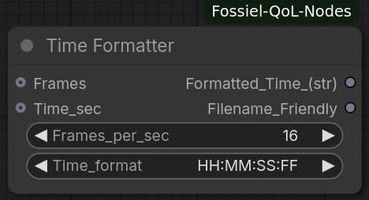

Converts between frame counts and time (seconds) and formats the result in a variety of human-readable or filename-friendly styles.

You may feed **either** a frame count **or** a time-in-seconds value (not both). The node then produces two string outputs: a display-oriented formatted time and a colon-free version safe for filenames.

#### Specifications

**Optional Inputs:**
1. **Frames** – Integer frame count  
2. **Time_sec** – Floating-point time in seconds  

**Parameters:**
1. **Frames_per_sec** – Frame rate used for the conversion (default: 16)  
2. **Time_format** – Desired output style:  
   - `Frames`  
   - `Time (sec)`  
   - `HH:MM:SS:FF`  
   - `HH:MM:SS:msec`  
   - `HH:MM:SS`  
   - `Total Seconds`  
   - `Total Frames`

**Outputs:**
1. **Formatted_Time_(str)** – Human-readable time string  
2. **Filename_Friendly** – Same value with `:` replaced by `-` (for time formats) so it can be used safely in filenames

**Notes:**
- Providing both Frames and Time_sec raises a clear error.  
- When the selected format matches the supplied input type the value is passed through with minimal reformatting.

---

### Unified Inpaint Sampler v2

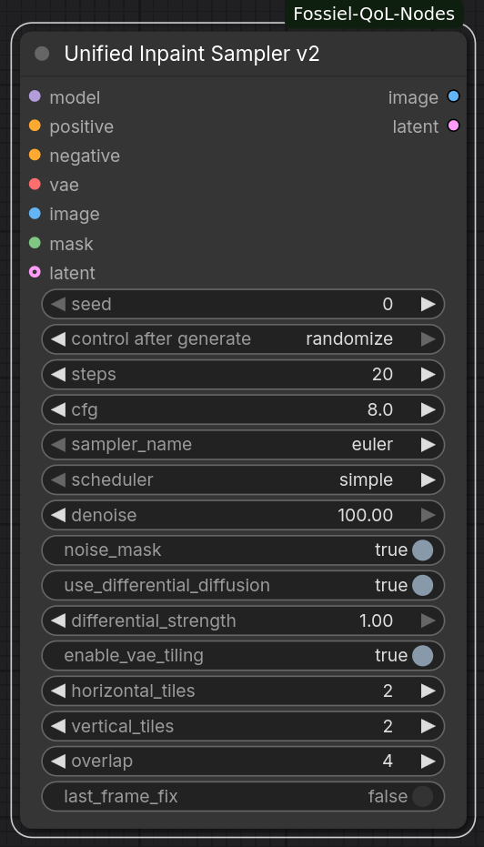

All-in-one advanced inpaint sampler. It performs inpaint conditioning, optional differential diffusion, sampling, and (optionally) tiled VAE decoding in a single node.

Denoise is expressed as a percentage (0.01–100.00) for fine control. Differential diffusion and a noise mask can be enabled independently. When VAE tiling is turned on, the decode stage is split into overlapping tiles with smooth blending, which is useful for large images or video latents.

Utilizes the tiler code from [ComfyUI-TiledVAELite](https://github.com/hum-ma/ComfyUI-TiledVaeLite)

#### Specifications

**Inputs:**
1. **model** – Diffusion model  
2. **positive** / **negative** – Conditioning  
3. **vae** – VAE for encode / decode  
4. **image** – Image to inpaint  
5. **mask** – Inpaint mask  
6. **latent** *(optional)* – Pre-existing latent (otherwise the image is encoded)

**Parameters:**
1. **seed**, **steps**, **cfg**, **sampler_name**, **scheduler** – Standard sampling controls  
2. **denoise** – Denoise strength as a percentage (default 100.00)  
3. **noise_mask** – Restrict sampling to the mask area (default: True)  
4. **use_differential_diffusion** – Enable differential diffusion (default: True)  
5. **differential_strength** – Strength of the differential diffusion effect (0.0–1.0)  
6. **enable_vae_tiling** – Use tiled VAE decode (default: True)  
7. **horizontal_tiles** / **vertical_tiles** – Tile grid size  
8. **overlap** – Overlap between tiles (in latent pixels)  
9. **last_frame_fix** – For video latents, duplicate the last frame before tiling (helps some VAEs)

**Outputs:**
1. **image** – Decoded result  
2. **latent** – Denoised latent (before decode)

---

### Video Level Matcher

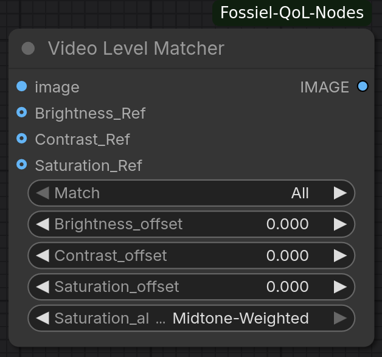

Per-frame version of Image Level Matcher designed for video batches. Each frame in the input batch is matched independently against the corresponding frame (or the last available frame) of the optional reference batches. This prevents the “global first-frame only” behaviour of the still-image matcher and eliminates flicker when the reference material also changes over time.

#### Specifications

**Inputs:**
1. **image** – Batch of frames to adjust (required)  
2. **Brightness_Ref** – Reference batch for brightness (optional)  
3. **Contrast_Ref** – Reference batch for contrast (optional)  
4. **Saturation_Ref** – Reference batch for saturation (optional)  

**Parameters:**  
1. **Match** – Same options as Image Level Matcher (`All`, `Brightness Only`, etc.)  
2. **Brightness_offset** / **Contrast_offset** / **Saturation_offset** – Fine-tune offsets  
3. **Saturation_algorithm** – `Global` or `Midtone-Weighted` (default)

**Outputs:**
1. **IMAGE** – Adjusted batch (same length as input)

**Notes:**
- If a reference batch is shorter than the input, the last reference frame is reused for remaining frames.
- Fully independent per-frame statistics → no temporal averaging.

---

### WebP Wrangler

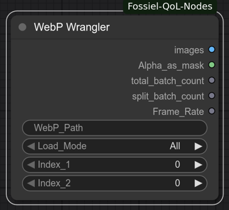

This node allows you to load and use animated WebP files, as though they were proper videos. You can manipulate the animated batch to your liking or output single frames. It also supports WebP files with an alpha channel.

#### Specifications

**Inputs:**
1. **WebP Path** – Full path to the animated WebP file (e.g., `C:/animation.webp`).  
2. **Load Mode** – Choose how to extract frames:  
   - `All` – Load every frame  
   - `From first to Index 1` – Frames 0 to value of Index_1  
   - `From Index 1 to last` – Value of Index_1 to final frame  
   - `Index 1 to Index 2` – Between two indices  
   - `First frame` – Only frame 0  
   - `Last frame` – Final frame  
   - `Index 1 frame` – Single frame at value of Index_1  
   (Important: For all batch modes, the range includes the indexed frame(s). E.g. In `From first to Index 1` mode, with an index value of 3, a batch count of 4 will be output.)  
3. **Index 1** – First index for range-based modes (0-based).  
4. **Index 2** – Second index for `Index 1 to Index 2` mode. (Ignored for all other modes)

**Outputs:**
1. **images** – Batch of RGB frames as `IMAGE` tensor (float32, 0–1).  
2. **Alpha as mask** – Alpha channel as grayscale mask (1.0 = opaque). Solid alpha (all 0 or 1) is normalized to 1.0.  
3. **total_batch_count** – Total number of frames in the WebP file.  
4. **split_batch_count** – Number of frames actually loaded.  
5. **Frame Rate** – Approximate FPS (rounded due to limitations of the webp library), or 10.0 if undetected.

**Notes:**
- Supports **animated WebP** with alpha transparency.
- Single-frame WebP returns a batch of 1.
- Errors (invalid path, corrupted file) raise clear messages.
- Frame rate is calculated from animation timestamps.

---
---

## Standalone Scripts

### reswrangler_sa.py

This cli script currently provides 2 simple, yet effective options for calculating coherent, non-fractional resolutions and aspect ratios. It is incredibly handy when preparing images in an external photo editor. The script prompts for inputs with clear language, making it very easy to use.  

To run the script, simply open a terminal at the script's location and run `python3 reswrangler_sa.py` in Linux/Mac or `python reswrangler_sa.py` in Windows. 

#### Specifications

1. **Best Fitting Coherent Aspect Ratio for Given Size** - Uses our algorithm from the Resolution Wrangler node to calculate the best fitting resolution and aspect ratio for a given size.  
2. **Closest Size Given Coherent Aspect and 1 Side** - Receives an integer aspect ratio and the length of one side of an image and then calculates the length of both sides that will fit the given aspect.
 
---
---

### Installation Instructions
1. Clone or download this repository to your local machine.
2. Copy the repository folder to your ComfyUI custom nodes directory: `ComfyUI/custom_nodes/`
3. Install dependencies by running:
    pip install -r ComfyUI/custom_nodes/ComfyUI-Fossiel-QoL-Nodes/requirements.txt
4. Restart ComfyUI to load the Fossiel Quality of Life nodes.
5. Find the nodes in ComfyUI under the category Fossiel/QoL.

---

## History
2026/10/30 - Added reswrangler_sa.py standalone script.  
2026/10/24 - Added FossielCentralControl_v3 (v2 kept for backwards compatibility).  
2026/10/24 - Added Video Level Matcher, Add Silence to Audio, Color Match (Passthrough Ports – credit to Kijai), Python Script (Simple).  
2026/10/24 - Added Sensor Switch Audio.  
2026/10/15 - Added video model selector in Pixel Budgeting node.  
2026/10/12 - Added support for MiniMax H3 latents to the Latent IO nodes.  
2026/10/12 - Bug Fixes in Resolution Wrangler  
2026/10/12 - Added Text Generate (Expanded) node  
2026/10/10 - Added Pixel Budgeting node.  
2026/09/27 - Bug fixes to Resolution Wrangler.  
2026/09/27 - Added Force Eager, Inpaint Conditioning, Latent I/O (Save / Load / Listener), Image Level Matcher Advanced, Time Formatter and Unified Inpaint Sampler nodes.  
2026/03/22 - Added nodes for SmolLM2 and SmolVLM2 prompt automation.  
2026/02/26 - Added Resolution Wrangler (Express) node.  
2026/02/26 - Added "Max Resolution x Ratio" option to Resolution Wrangler  
2026/02/19 - Fixed null mask error and 1 to 1 resize bug in Resolution Wrangler  
2026/02/14 - Added Resolution Wrangler  
2026/02/07 - Added Denoise Precision KSampler node  
2026/02/07 - Added Video De-flicker node  
2026/02/07 - Fixed a bug in Sensor Switch Latent and Sensor Switch KSampler that prevented inpainted latents from being passed correctly.  
2026/02/07 - Renamed Image Level Matchmaker to Image Level Matcher  
2026/02/07 - Adjusted setting tolerances from 0.01 to 0.001 in Image Level Matchmaker  
2026/02/07 - Moved Qwen Size Stabilizer to ComfyUI-Fossiel-QwenHelpers.  
2025/12/28 - Updated Image Level Matchmaker.  
2025/12/23 - Added Image Level Matchmaker  
2025/12/10 - Fixed the loading bug in Sequence Wrangler.  
2025/11/29 - Added Sequence Wrangler for loading and manipulation of image sequences.  
2025/11/17 - Added Qwen Size Stabilizer for predictable Qwen generations.  
2025/10/31 - Updated the Sensor KSampler Switch to have switching support for all KSampler and KSampler (Advanced) input ports.  
2025/10/31 - Added WAN 2.1 & 2.2 support to the Sensor Switch Latent node.  
2025/10/28 - Added WebP Wrangler for animated WebP loading with frame range control.  
2025/10/28 - Updated FossielCentralControl_v2: Added Project_Name, renamed Name → Scene_Name, improved naming logic (no double delimiters).  
2025/10/27 - Added Sensor Switch Nodes.  
2025/10/26 – Launched with Fossiel Central Control node.  

---

## Credits  
Developed with help from Grok3 and newer.  
All the developers who make tools available to everyone using local AI  
Model developers for supplying fantastic open source models, free of charge.  
**Kijai** – Original ColorMatch node (ComfyUI-KJNodes) which this pack’s Color Match is based on.
